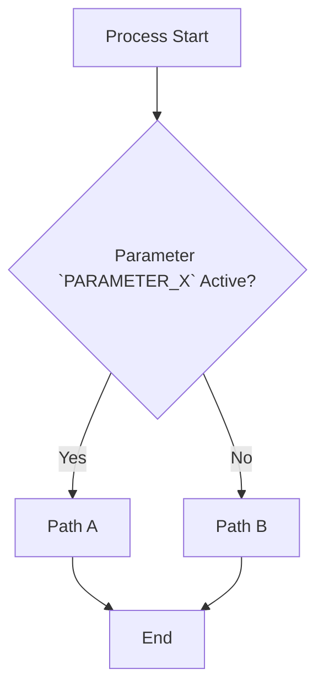

# Domain-Based Flow & Business Rules Documenter

## Objective

Map the end-to-end flow of a legacy system organized by **domain/module subfolders**, producing a document in `docs/fluxos/[domain-name]/[flow-name].md` containing an overview, **Mermaid** flowchart, parameter mapping table, and cross-updates to related parameter files in `docs/parametros/`.

## Directory Structure

Flow documentation files must be saved inside subfolders organized by business domain:
`docs/fluxos/[domain-name]/[flow-name].md` *(Example: `docs/fluxos/purchase-orders/FLOW-dropshipping-purchase.md`)*

## Generated Document Structure

Strictly structure the flow document using this template (adjusting relative link paths based on subfolder depth):

````markdown
# Flow: [Flow Name]

## 1. Business Overview
Clear summary explaining the end-to-end purpose of this flow in the system.

## 2. Flow Diagram (Mermaid)
Create a `mermaid` flowchart (`graph TD` type) highlighting the exact points where parameters branch conditional execution paths (`if/else`).



## 3. Associated Parameters Table

Consolidated list of configuration parameters governing this specific flow, with relative links adjusted to the parameters directory (e.g., `../../parametros/`):

| Parameter | Type | Primary Behavior | Details Link |
| --- | --- | --- | --- |
| `PARAMETER_X` | Boolean | Selects between path A and B. | [`View Details`](../../parametros/PARAMETER_X.md) |
````

## Execution Guidelines

1. Define the appropriate domain subfolder (e.g., `purchase-orders`, `billing`, `logistics`) based on code context.
2. Analyze execution order and conditional branching to build the `mermaid` flowchart.
3. Ensure relative links to the parameters directory are correct according to subfolder depth (typically `../../parametros/` for files nested inside a domain subfolder).
4. **Cross-Update:** Check and update individual `.md` files in `docs/parametros/`, ensuring they include a backlink to this flow under the `#### 🔄 Affected Flows` section pointing to the correct relative path (e.g., `../fluxos/[domain-name]/[flow-name].md`).